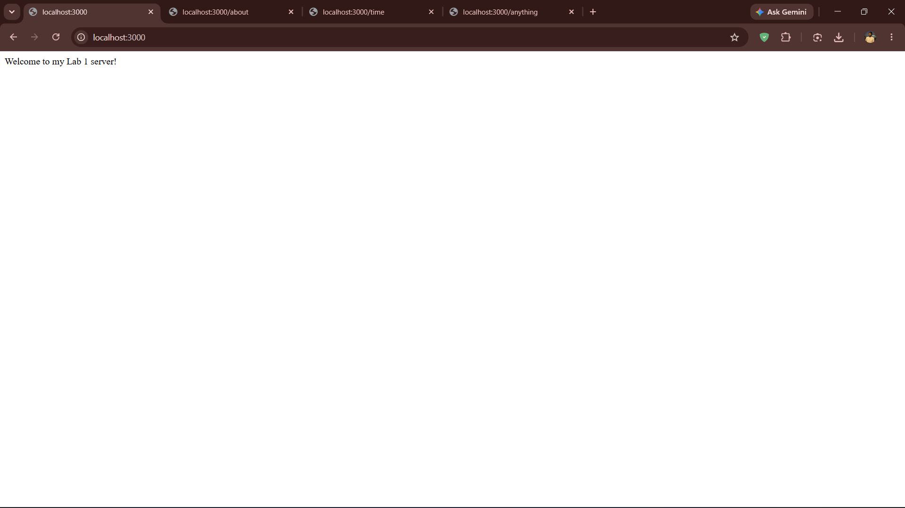
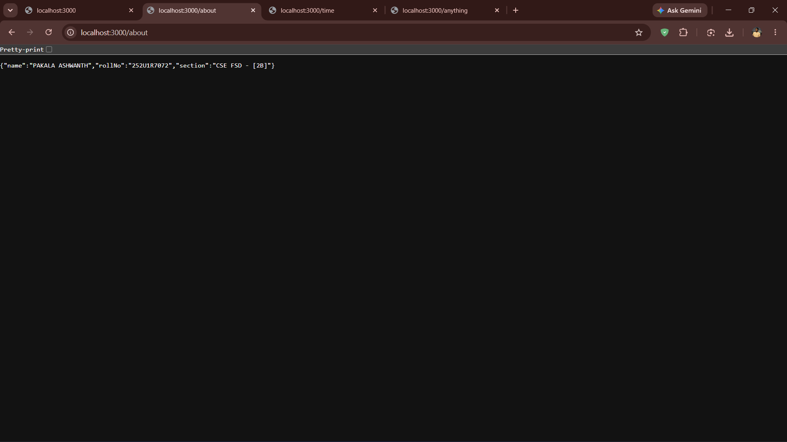
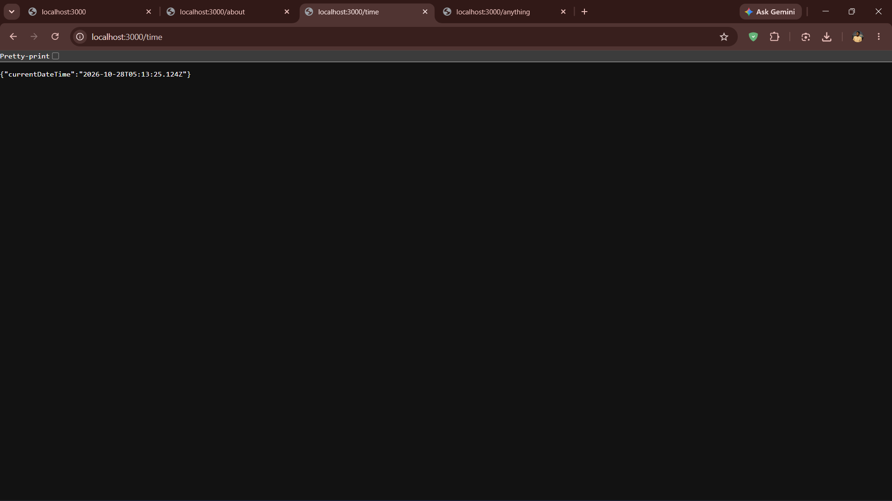
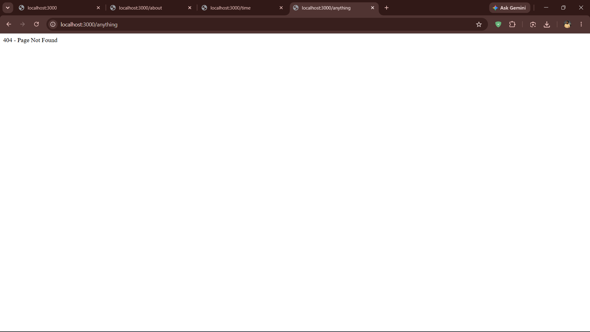

# Lab 1: Node.js and Express Server

## Student Details

- **Name:** PAKALA ASHWANTH
- **Registration Number:** 252U1R7072
- **Section:** CSE FSD - [2B]
- **Course:** Backend Development Fundamentals
- **Lab Number:** 01

## Live Link

Deployment is pending. A persistent Node.js/Express server requires a backend runtime (such as Render, Railway, or Heroku). Local testing is fully functional on `http://localhost:3000`.

## Objective

To set up a Node.js project, create a basic HTTP server using the built-in `http` module, and build an Express server with multiple routes and appropriate HTTP status codes.

## Technologies Used

- Node.js
- Express.js
- JavaScript
- npm
- Visual Studio Code

## Project Structure

```text
lab-01/
├── screenshots/
│   ├── home.png
│   ├── about.png
│   ├── time.png
│   └── not-found.png
├── server-http.js
├── server.js
├── package.json
├── package-lock.json
├── .gitignore
└── README.md
```

## package.json Fields Explained

| Field | Description |
|---|---|
| `name` | The name of the project (`express-js-lab-1`) |
| `version` | The current version of the project (`1.0.0`) |
| `main` | The entry point file of the project (`server-http.js`) |
| `scripts` | Custom commands — `start` runs `node server.js` |
| `dependencies` | Lists the packages the project depends on (here, `express`) |

## Installation and Setup

### Prerequisites

- Node.js and npm installed
- Visual Studio Code or another code editor

### Steps to Run

1. Clone the repository or download the project.
2. Open the project folder in the terminal.
3. Install the dependencies:

   ```bash
   npm install
   ```

4. Start the Express server:

   ```bash
   node server.js
   ```

5. Open the following URL in your browser:

   `http://localhost:3000`

## How to Run the Basic HTTP Server

To run the server implemented using Node.js's built-in HTTP module:

```bash
node server-http.js
```

Stop the running server with `Ctrl + C` before starting another server on the same port.

## Endpoints

| Method | Endpoint | Description | Expected Status |
|---|---|---|---|
| GET | `/` | Returns a welcome message | 200 OK |
| GET | `/about` | Returns the student's name and section as JSON | 200 OK |
| GET | `/time` | Returns the current date and time | 200 OK |
| GET | `/anything` | Demonstrates the response for an unknown route | 404 Not Found |

The `/anything` path is an example of an unknown route. All other undefined paths also return a 404 response.

## Screenshots

### 1. Home Route

Displays the welcome message.



### 2. About Route

Displays the student's name and section in JSON format.



### 3. Time Route

Displays the current date and time.



### 4. Unknown Route

Displays the 404 Page Not Found response.



## HTTP Status Codes

- **200 OK:** The request was successful.
- **404 Not Found:** The requested route does not exist.

## Viva Questions and Answers

### 1. What is the difference between `package.json` and `node_modules`?

`package.json` stores project metadata, scripts, and dependency information. `node_modules` contains the actual installed packages required by the project. You commit `package.json` to Git but never commit `node_modules/`.

### 2. What does `app.listen()` do?

`app.listen()` starts the Express server and makes it listen for incoming HTTP requests on a specified port number. For example, `app.listen(3000)` means the server will accept requests on port 3000.

### 3. What do `request` and `response` represent?

`request` (often written as `req`) contains information about the incoming HTTP request, such as the URL, method, headers, and body. `response` (often written as `res`) is used to send data, status codes, and headers back to the client.

## Problems Faced and Solutions

- **Problem:** PowerShell on Windows blocks script execution by default (`npm` command fails).
  **Solution:** Run `Set-ExecutionPolicy -Scope Process -ExecutionPolicy Bypass` in the terminal session before using npm.

- **Problem:** Both `server-http.js` and `server.js` use port 3000, so only one can run at a time.
  **Solution:** Stop the running server with `Ctrl + C` before starting the other server.

## Git and Repository Notes

- The `.gitignore` file excludes `node_modules/` and `.env`.
- The `node_modules/` directory must not be committed to Git.
- Screenshots are stored in the `screenshots/` directory.
- The project is submitted through the course GitHub repository.
